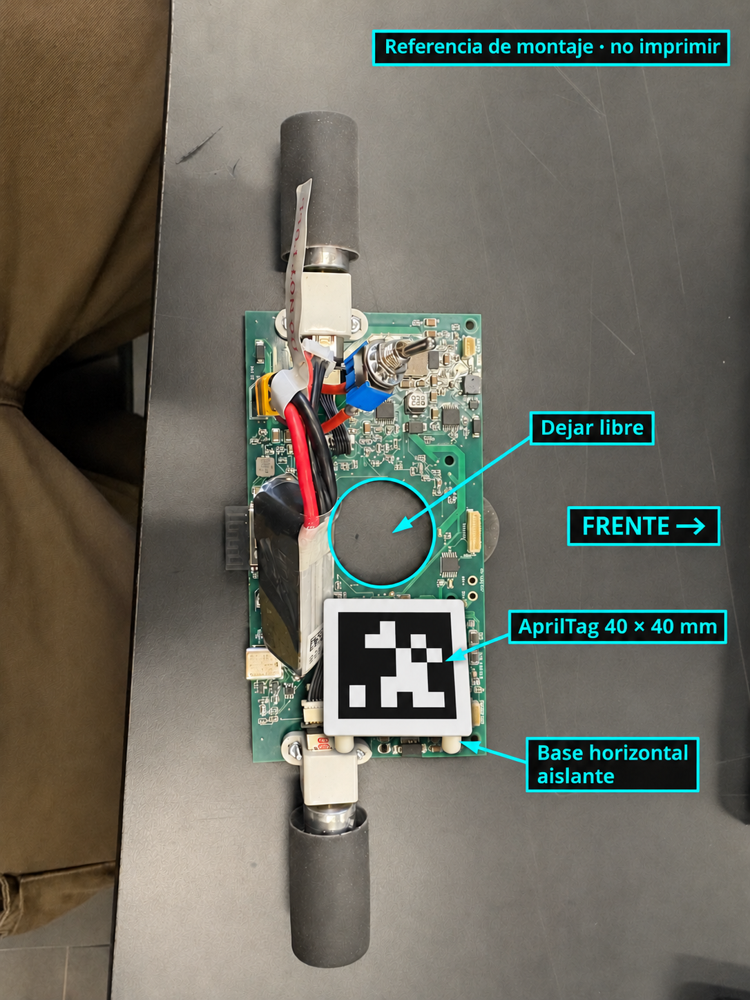

# Prueba del robot con webcam

Esta prueba usa Python y OpenCV. Abre una vista local en el navegador y detecta
un AprilTag 36h11, identificador 0. No inicia Webots, no necesita ROS 2 y no
envía órdenes a los motores.

## Colocar el marcador



En la fotografía del montaje, el frente del robot apunta hacia la derecha.
Coloca una base rígida, horizontal y aislante sobre la zona del extremo inferior
de la batería, hacia el motor inferior. La posición exacta depende del soporte:
debe quedar por encima de cables y componentes, sin apoyarse sobre ellos y
dejando libres el hueco de la turbina, las ruedas y los conectores.

La ilustración indica una ubicación aproximada; no es una plantilla dimensional
del soporte ni el archivo que se debe imprimir.

La tarjeta nueva mide **65 × 65 mm en total**, con un patrón negro de
**52 × 52 mm** y **6,5 mm blancos por cada lado**. Imprime
[el PDF A4 de 65 mm](../simulation/webcam/assets/apriltag-0-65mm-a4.pdf)
al **100 %, tamaño real**, sin ajustar a página. Comprueba su barra de 50 mm
con una regla. Recorta sin reducir el margen blanco; la flecha de orientación
queda fuera de la tarjeta y solo indica qué borde debe apuntar al frente.
Usa una impresión mate, sin reflejos ni curvaturas.

En **Cámara → Marcador y escala**, selecciona **Nueva: tarjeta de 65 mm**
y vuelve a **Calibrar robot** con sus dos clics. El programa usa los **52 mm
del patrón**, no los 65 mm del papel, para calcular distancias. Cambiar la
selección no modifica la calibración guardada ni envía órdenes de movimiento.
El tamaño queda asociado a la calibración al confirmar el centro y el frente.

El [PDF anterior de patrón de 40 mm](../simulation/webcam/assets/apriltag-0-40mm.pdf)
y su [PNG con margen](../simulation/webcam/assets/apriltag-0-margen.png) siguen
disponibles. Mantén **Anterior: patrón de 40 mm** mientras uses esa impresión.
Una calibración existente conserva su tamaño hasta que la reemplaces.

## Abrir la prueba

Desde la carpeta del repositorio:

```sh
uv sync --frozen
./simulation/webcam/run.command
```

También puedes hacer doble clic en `simulation/webcam/run.command`. El panel se
abre en **http://127.0.0.1:8010/**. La captura permanece apagada hasta pulsar
**Iniciar cámara**. No hace falta instalar los componentes del simulador, Node ni Webots.
Para usar otro puerto: `./simulation/webcam/run.command --port 8012`.

1. Conecta la webcam y sitúala fija encima del área de prueba, mirando al suelo.
2. En macOS, selecciona la webcam por su **nombre** y pulsa **Iniciar cámara**. El panel
   recomienda una cámara USB cuando la encuentra. Si acabas de conectarla, pulsa
   **Actualizar cámaras** con la captura detenida. El nombre también aparece
   sobre la imagen. Si no se pueden consultar los nombres, se muestran índices
   manuales y se indica esa limitación.
3. Si macOS solicita acceso a Cámara, permítelo para la aplicación que lanza
   Python. Si no aparece la imagen, comprueba Ajustes del Sistema → Privacidad y
   seguridad → Cámara y cierra otras aplicaciones que estén usando la webcam.
4. Sitúa el robot a la vista. El recuadro delimita el marcador; el punto señala
   su centro y la flecha indica el frente del robot.
5. Pulsa **Detener cámara** para liberar la cámara. Cierra el servidor con Ctrl+C en su
   terminal antes de abrir una nueva instancia en el mismo puerto.

La página y sus recursos funcionan sin Internet después de instalar dependencias.
No se guardan fotografías ni vídeos. La captura se hace con OpenCV en Python,
no con la cámara del navegador. Un permiso del navegador no reemplaza el de macOS.

## Panel de operación

**Iniciar recorrido** y **Detener robot** permanecen en la cabecera; en
pantallas pequeñas aparecen fijos abajo. Las herramientas **Puntos**,
**Perímetro**, **Casa** y **Calibrar robot** están junto a la imagen.

- **Recorrido:** velocidades de avance y giro, gestión de puntos y ajustes de
  perímetros. **Casa y manos** despliega sus reacciones y parámetros.
- **Cámara:** selección de webcam, captura, iluminación y tamaño del marcador.
- **Conexión:** estado del enlace, configuración Wi-Fi por USB y prueba manual
  de motores dentro de un desplegable separado.

Las pestañas admiten flechas izquierda/derecha y las teclas Inicio/Fin, con foco
visible. Cambiar de pestaña, abrir ayudas o elegir el tamaño del marcador no
inicia movimiento. Un aviso junto a la imagen indica el siguiente paso necesario.

**Detener robot** solicita en paralelo cancelar la navegación y detener los
motores; también desarma la reacción a manos. Permanece disponible si se pierde
la cámara o el enlace. Si falta la confirmación física, el panel lo indica sin
afirmar que el robot se detuvo. **Detener cámara** solo libera la captura;
**Cancelar recorrido** cancela la misión y **Borrar puntos** además vacía sus
destinos. El control local y la planificación no cambian al reorganizar el panel.

Se aplican jerarquía visual, agrupación por tarea, divulgación progresiva,
controles de al menos 44 px en las acciones principales, contraste y foco
visible. Son decisiones basadas en las [heurísticas de Nielsen](https://www.nngroup.com/articles/ten-usability-heuristics/),
la [ley de Fitts](https://www.nngroup.com/articles/fitts-law/) y criterios de
[WCAG 2.2](https://www.w3.org/WAI/WCAG22/Understanding/). La revisión no constituye
una certificación de accesibilidad: el dibujo sobre la imagen requiere puntero.

## Iluminación, sombras y reflejos

En la pestaña **Cámara**, pulsa **Optimizar iluminación** para activar la compensación
digital automática y el contraste local. El cambio se aplica al vídeo y a las
imágenes candidatas del detector AprilTag, sin reiniciar la webcam, recortar,
girar ni desplazar la imagen. El detector conserva también el original como
candidato y sigue exigiendo el identificador 0: un reflejo o un cuadrado no se
aceptan como un marcador. La captura original, con su secuencia y tiempo,
permanece como entrada del trabajador de manos.

Dentro de **Ajustes de imagen** puedes cambiar:

- **Brillo:** de -60 a 60 niveles de luminancia.
- **Contraste:** de 0,5 a 2,5, alrededor del nivel medio.
- **Gamma:** de 0,5 a 2; en esta interfaz, valores mayores que 1 aclaran.
- **Luminosidad automática** y **Mejorar contraste local**.

Mover un slider activa el ajuste manual; el botón de optimización recupera los
valores automáticos. **Restablecer imagen original** desactiva las correcciones.
Los ajustes se guardan en `simulation/.runtime/camera-illumination.json` y se
conservan al detener o reconectar la cámara y al reiniciar el servicio. No se
borran los puntos, los perímetros ni la calibración, y este control no inicia
movimiento ni rearma una sesión del robot.

Son ajustes de píxeles, no un control físico de exposición. OpenCV AVFoundation
en macOS no implementa los controles numéricos de brillo, ganancia o exposición
para esta captura. La compensación utiliza el canal de luminancia, un contraste
local moderado y curvas gamma, conservando resolución y crominancia. El panel
muestra la luminosidad y el porcentaje de altas luces de la captura original,
sin ocultar el recorte que ya produjo la cámara.

Si el reflejo deja el papel completamente blanco, no hay detalle que el filtro
pueda recuperar: cambia el ángulo de cámara o de luz y evita acabados brillantes
en el marcador. El contraste mejora la información disponible; no reconstruye
las celdas perdidas. Tampoco puede reparar desenfoque u oclusión.

La revisión de noviembre de 2026 añade pruebas sin hardware de rangos y
persistencia, ajuste durante captura sin reapertura, geometría y datos originales
para manos, identidad del tag, serialización de sliders y respuestas atrasadas.

Referencias técnicas: [backend AVFoundation de OpenCV](https://github.com/opencv/opencv/blob/4.14.0/modules/videoio/src/cap_avfoundation_mac.mm),
[transformaciones de brillo y contraste](https://docs.opencv.org/4.x/d3/dc1/tutorial_basic_linear_transform.html)
y [contraste local CLAHE](https://docs.opencv.org/4.x/d5/daf/tutorial_py_histogram_equalization.html).

## Qué se mide

- Centro **del marcador**, en píxeles; no es el centro entre las ruedas.
- Orientación en la imagen sin espejo: 0° hacia la derecha, 90° hacia arriba,
  180° hacia la izquierda y 270° hacia abajo.
- Frecuencia de fotogramas procesados y duración de la detección. No son una
  medición de la latencia completa desde el sensor de la webcam.

No requiere calibración para esta primera comprobación. No entrega distancias
en metros ni orientación corregida de perspectiva. Antes de navegar con el
robot real habrá que calibrar la cámara, medir la posición del marcador respecto
al robot y establecer las coordenadas del suelo; los valores del simulador no
se aplican automáticamente al montaje físico.

## Comprobar la detección

Con el robot quieto y moviéndolo a mano:

1. Comprueba las cuatro orientaciones y una vuelta completa: la flecha debe
   apuntar siempre al frente real, sin intercambiarlo con la parte trasera.
2. Desplázalo por el encuadre y comprueba que el recuadro acompaña al marcador.
3. Tapa el patrón o sácalo del encuadre. Deben desaparecer el recuadro, el centro
   y la orientación; no debe conservarse una posición antigua como válida.
4. Destápalo y comprueba que recupera la detección. Detén, vuelve a iniciar y
   verifica que la cámara queda disponible. Una desconexión o un fotograma
   atrasado también retiran la orientación.

Si falla al moverse, mejora la iluminación, reduce reflejos y acerca la cámara
o reduce su campo de visión. El tamaño adecuado se confirma con la webcam real;
los 40 mm son el punto de partida, no una garantía para cualquier altura.

## Desarrollo

```sh
.venv/bin/python -m pytest simulation/tests/test_webcam.py -q
uv sync --frozen --extra assets
.venv/bin/python -m simulation.tools.build_webcam_assets
```

Las pruebas utilizan imágenes generadas y una cámara simulada; no abren hardware.
El detector y la captura son independientes del servicio de navegación.
La entrega pasa 108 pruebas específicas de webcam y las 179 pruebas del proyecto.
Se comprobó la detección del PDF renderizado, la inclusión de recursos en el
paquete instalable y el panel con imágenes generadas, incluidas pérdida de
detección y parada. La webcam Trust 1080p Full HD conectada por USB se comprobó
en este Mac, transmitiendo imágenes de 1280 × 720 píxeles al panel. La detección
del marcador con la impresión y montaje físicos queda pendiente de realizar
con el robot.

El selector consulta AVFoundation sin abrir las cámaras y conserva el mismo
orden que [OpenCV en macOS](https://github.com/opencv/opencv/blob/4.14.0/modules/videoio/src/cap_avfoundation_mac.mm).
Al iniciar, vuelve a resolver el identificador del dispositivo para evitar abrir
otra cámara si cambian los índices al conectar o desconectar un equipo. Si no
está disponible, solicita actualizar la lista. Durante el arranque tolera hasta
cinco segundos de lecturas inicialmente vacías; una pérdida posterior de la
captura sigue retirando la posición y orientación.

### Reinicio y reconexión USB en macOS

Al cambiar de puerto, la Trust recibió un identificador nuevo. Se comprobó que
el servicio antiguo seguía enumerando el identificador anterior, mientras un
proceso nuevo veía el actual. Por eso la enumeración ahora se consulta en un
proceso breve y cada sesión de captura abre AVFoundation en su propio proceso
nuevo. Los píxeles se trasladan por memoria compartida, conservando el último
fotograma y su marca de tiempo. Detener también puede cancelar una apertura o
lectura bloqueada y liberar la cámara.

Antes de iniciar, el panel refresca los dispositivos. Si el identificador cambió,
solo recupera automáticamente la selección cuando hay una única cámara con el
mismo nombre exacto. Si falta o el nombre es ambiguo, pide seleccionar la cámara;
no abre otra por su posición en la lista.

Con el cambio instalado se completaron tres aperturas reales seguidas de la
Trust a 1280 × 720 píxeles, con unos 2,9 segundos hasta recibir al menos cuatro
fotogramas por sesión. Las pruebas automatizadas cubren identificadores que
cambian, cámara ausente, cancelación de controladores bloqueados y liberación
de los procesos y de la memoria. El cambio físico de puerto con el servicio
nuevo ya abierto todavía no se ha repetido como prueba manual.

### Contornos del marcador impreso

El detector prueba primero la configuración estándar y después dos
aproximaciones del contorno para tolerar pequeñas irregularidades del recorte
o sombras del soporte, antes de ampliar la imagen. Mantiene el diccionario,
la comprobación del identificador 0 y la corrección de bits originales. No
convierte un cuadrado rechazado en una posición válida.

La comparación local recuperó 13 de 13 imágenes nítidas del robot que antes
se perdían por el contorno; los 10 fotogramas con desenfoque fuerte del mismo
lote permanecieron sin detección. Esto valida esos fotogramas, no cualquier
montaje o velocidad. En una vista más cercana, el patrón válido pero recortado
hasta el negro volvió a perderse: el margen blanco continuo de 5 mm sigue
siendo necesario para un montaje fiable. La comprobación con la nueva impresión
física queda pendiente; los ajustes no reemplazan ese margen. El patrón debe
estar visible y suficientemente enfocado para obtener una orientación válida.
Se añadieron también 24 pruebas de tarjeta con el margen correcto: patrón de
48, 80 y 160 píxeles, cuatro orientaciones y dos condiciones de iluminación.
Todas conservan la identidad y el sentido del frente, sin ajustes adicionales
de la corrección de bits. Son comprobaciones sintéticas, no mediciones de la
nueva impresión física.

La referencia anotada se generó mediante imagegen a partir de la foto aportada;
sus instrucciones están registradas en `docs/recursos-webcam.json`. El PDF y el
PNG imprimibles se generan de manera determinista desde el diccionario de OpenCV.
