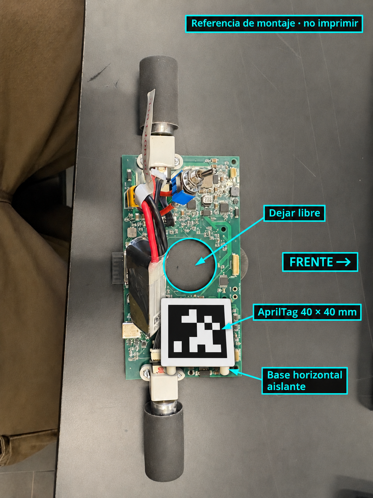

# Prueba del robot con webcam

Esta prueba usa Python y OpenCV. Abre una vista local en el navegador y detecta
un AprilTag 36h11, identificador 0. No inicia Webots, no necesita ROS 2 y no
envía órdenes a los motores.

## Colocar el marcador



En la fotografía del montaje, el frente del robot apunta hacia la derecha.
Coloca una base rígida, horizontal y aislante sobre la zona del extremo inferior
de la batería, hacia el motor inferior. La posición exacta depende del soporte:
debe quedar por encima de cables y componentes, sin apoyarse sobre ellos y
dejando libres el hueco de la turbina, las ruedas y los conectores.

La ilustración indica una ubicación aproximada; no es una plantilla dimensional
del soporte ni el archivo que se debe imprimir.

Imprime [el PDF del marcador](../simulation/webcam/assets/apriltag-0-40mm.pdf)
al **100 %, tamaño real**, desactivando ajustar a página. Comprueba con una regla
la referencia de 40 mm. El patrón negro mide 40 × 40 mm y tiene 5 mm de margen
blanco en cada lado. La tarjeta mide 50 × 62 mm porque incluye una franja
adicional para la flecha de orientación, fuera del margen blanco del patrón.
Recórtala por el borde exterior de puntos y fija la flecha **FRENTE** hacia el
frente real del robot. Usa una impresión mate, sin reflejos ni curvaturas.

El [PNG original con margen](../simulation/webcam/assets/apriltag-0-margen.png)
también está disponible. Su tamaño físico depende de la configuración de
impresión; el PDF es la opción recomendada para conservar los 40 mm.

## Abrir la prueba

Desde la carpeta del repositorio:

```sh
uv sync --frozen
./simulation/webcam/run.command
```

También puedes hacer doble clic en `simulation/webcam/run.command`. El panel se
abre en **http://127.0.0.1:8010/**. La captura permanece apagada hasta pulsar
**Iniciar**. No hace falta instalar los componentes del simulador, Node ni Webots.
Para usar otro puerto: `./simulation/webcam/run.command --port 8012`.

1. Conecta la webcam y sitúala fija encima del área de prueba, mirando al suelo.
2. En macOS, selecciona la webcam por su **nombre** y pulsa **Iniciar**. El panel
   recomienda una cámara USB cuando la encuentra. Si acabas de conectarla, pulsa
   **Actualizar cámaras** con la captura detenida. El nombre también aparece
   sobre la imagen. Si no se pueden consultar los nombres, se muestran índices
   manuales y se indica esa limitación.
3. Si macOS solicita acceso a Cámara, permítelo para la aplicación que lanza
   Python. Si no aparece la imagen, comprueba Ajustes del Sistema → Privacidad y
   seguridad → Cámara y cierra otras aplicaciones que estén usando la webcam.
4. Sitúa el robot a la vista. El recuadro delimita el marcador; el punto señala
   su centro y la flecha indica el frente del robot.
5. Pulsa **Detener** para liberar la cámara. Cierra el servidor con Ctrl+C en su
   terminal antes de abrir una nueva instancia en el mismo puerto.

La página y sus recursos funcionan sin Internet después de instalar dependencias.
No se guardan fotografías ni vídeos. La captura se hace con OpenCV en Python,
no con la cámara del navegador. Un permiso del navegador no reemplaza el de macOS.

## Qué se mide

- Centro **del marcador**, en píxeles; no es el centro entre las ruedas.
- Orientación en la imagen sin espejo: 0° hacia la derecha, 90° hacia arriba,
  180° hacia la izquierda y 270° hacia abajo.
- Frecuencia de fotogramas procesados y duración de la detección. No son una
  medición de la latencia completa desde el sensor de la webcam.

No requiere calibración para esta primera comprobación. No entrega distancias
en metros ni orientación corregida de perspectiva. Antes de navegar con el
robot real habrá que calibrar la cámara, medir la posición del marcador respecto
al robot y establecer las coordenadas del suelo; los valores del simulador no
se aplican automáticamente al montaje físico.

## Comprobar la detección

Con el robot quieto y moviéndolo a mano:

1. Comprueba las cuatro orientaciones y una vuelta completa: la flecha debe
   apuntar siempre al frente real, sin intercambiarlo con la parte trasera.
2. Desplázalo por el encuadre y comprueba que el recuadro acompaña al marcador.
3. Tapa el patrón o sácalo del encuadre. Deben desaparecer el recuadro, el centro
   y la orientación; no debe conservarse una posición antigua como válida.
4. Destápalo y comprueba que recupera la detección. Detén, vuelve a iniciar y
   verifica que la cámara queda disponible. Una desconexión o un fotograma
   atrasado también retiran la orientación.

Si falla al moverse, mejora la iluminación, reduce reflejos y acerca la cámara
o reduce su campo de visión. El tamaño adecuado se confirma con la webcam real;
los 40 mm son el punto de partida, no una garantía para cualquier altura.

## Desarrollo

```sh
.venv/bin/python -m pytest simulation/tests/test_webcam.py -q
uv sync --frozen --extra assets
.venv/bin/python -m simulation.tools.build_webcam_assets
```

Las pruebas utilizan imágenes generadas y una cámara simulada; no abren hardware.
El detector y la captura son independientes del servicio de navegación.
La entrega pasa 108 pruebas específicas de webcam y las 179 pruebas del proyecto.
Se comprobó la detección del PDF renderizado, la inclusión de recursos en el
paquete instalable y el panel con imágenes generadas, incluidas pérdida de
detección y parada. La webcam Trust 1080p Full HD conectada por USB se comprobó
en este Mac, transmitiendo imágenes de 1280 × 720 píxeles al panel. La detección
del marcador con la impresión y montaje físicos queda pendiente de realizar
con el robot.

El selector consulta AVFoundation sin abrir las cámaras y conserva el mismo
orden que [OpenCV en macOS](https://github.com/opencv/opencv/blob/4.14.0/modules/videoio/src/cap_avfoundation_mac.mm).
Al iniciar, vuelve a resolver el identificador del dispositivo para evitar abrir
otra cámara si cambian los índices al conectar o desconectar un equipo. Si no
está disponible, solicita actualizar la lista. Durante el arranque tolera hasta
cinco segundos de lecturas inicialmente vacías; una pérdida posterior de la
captura sigue retirando la posición y orientación.

### Reinicio y reconexión USB en macOS

Al cambiar de puerto, la Trust recibió un identificador nuevo. Se comprobó que
el servicio antiguo seguía enumerando el identificador anterior, mientras un
proceso nuevo veía el actual. Por eso la enumeración ahora se consulta en un
proceso breve y cada sesión de captura abre AVFoundation en su propio proceso
nuevo. Los píxeles se trasladan por memoria compartida, conservando el último
fotograma y su marca de tiempo. Detener también puede cancelar una apertura o
lectura bloqueada y liberar la cámara.

Antes de iniciar, el panel refresca los dispositivos. Si el identificador cambió,
solo recupera automáticamente la selección cuando hay una única cámara con el
mismo nombre exacto. Si falta o el nombre es ambiguo, pide seleccionar la cámara;
no abre otra por su posición en la lista.

Con el cambio instalado se completaron tres aperturas reales seguidas de la
Trust a 1280 × 720 píxeles, con unos 2,9 segundos hasta recibir al menos cuatro
fotogramas por sesión. Las pruebas automatizadas cubren identificadores que
cambian, cámara ausente, cancelación de controladores bloqueados y liberación
de los procesos y de la memoria. El cambio físico de puerto con el servicio
nuevo ya abierto todavía no se ha repetido como prueba manual.

### Contornos del marcador impreso

El detector prueba primero la configuración estándar y después dos
aproximaciones del contorno para tolerar pequeñas irregularidades del recorte
o sombras del soporte, antes de ampliar la imagen. Mantiene el diccionario,
la comprobación del identificador 0 y la corrección de bits originales. No
convierte un cuadrado rechazado en una posición válida.

La comparación local recuperó 13 de 13 imágenes nítidas del robot que antes
se perdían por el contorno; los 10 fotogramas con desenfoque fuerte del mismo
lote permanecieron sin detección. Esto valida esos fotogramas, no cualquier
montaje o velocidad. En una vista más cercana, el patrón válido pero recortado
hasta el negro volvió a perderse: el margen blanco continuo de 5 mm sigue
siendo necesario para un montaje fiable. La comprobación con la nueva impresión
física queda pendiente; los ajustes no reemplazan ese margen. El patrón debe
estar visible y suficientemente enfocado para obtener una orientación válida.
Se añadieron también 24 pruebas de tarjeta con el margen correcto: patrón de
48, 80 y 160 píxeles, cuatro orientaciones y dos condiciones de iluminación.
Todas conservan la identidad y el sentido del frente, sin ajustes adicionales
de la corrección de bits. Son comprobaciones sintéticas, no mediciones de la
nueva impresión física.

La referencia anotada se generó mediante imagegen a partir de la foto aportada;
sus instrucciones están registradas en `docs/recursos-webcam.json`. El PDF y el
PNG imprimibles se generan de manera determinista desde el diccionario de OpenCV.
